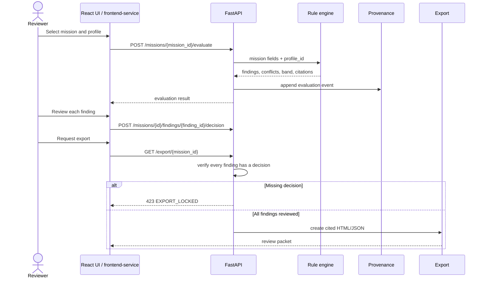
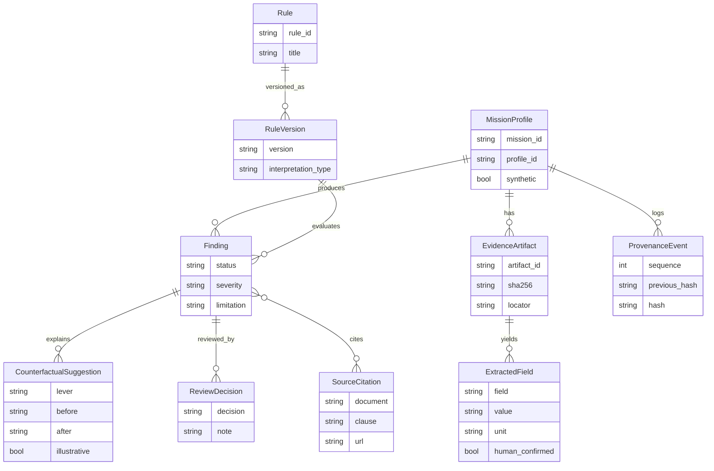
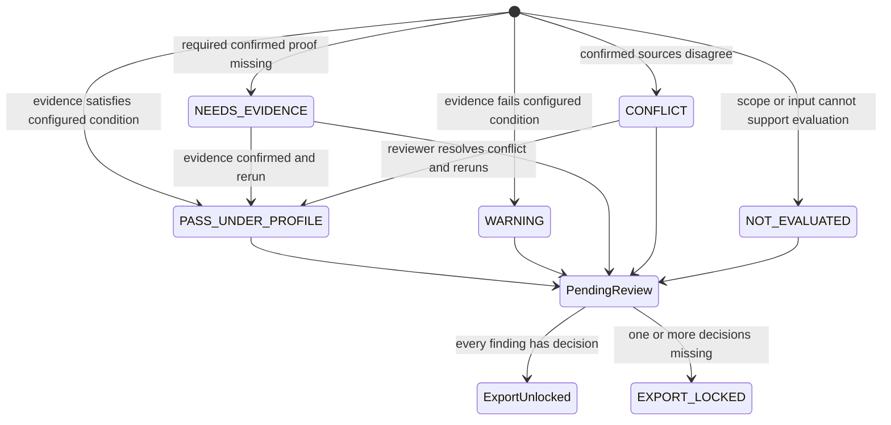

# OrbitScore diagrams — verified package map

> OrbitScore is a decision-support/pre-review workflow, not legal certification, collision prediction, an operational conjunction-alert service, or a replacement for NASA Debris Assessment Software. Demo missions and counterfactuals are synthetic and illustrative.

## 1. Architecture and decision authority

```mermaid
flowchart LR
  U[Mission team / reviewer] --> UI[Canonical React + TypeScript UI (frontend/)]
  UI -.->|API client| API[FastAPI backend/app/main.py]
  API --> E[engine.py: selected-profile rules]
  E --> R[rules_profiles.json]
  API --> P[provenance.py: SHA-256 chain]
  API --> X[export.py: cited HTML/JSON]
  API -.-> AI[ai_ml adapter: unconfirmed candidates only]
  E --> F[Findings: five explicit states]
  F --> G{Decision persisted
for every finding?}
  G -->|No| L[EXPORT_LOCKED]
  G -->|Yes| O[Review packet]
  UI --> H[Human confirmation and review]
  H -->|confirmed fields / decisions| API
```

The deterministic evaluator only uses human-confirmed values for rules that require confirmation. The human selects the profile, reviews scope and conflicts, and owns all engineering or regulatory decisions. Browser mock state persists in localStorage; the API demo state lasts only for the process lifetime.

## 2. Target live API review sequence (T001; not yet wired to the current UI)

The sequence below describes the desired live browser-to-FastAPI integration. The current React app uses the local/mock adapter; the API routes work separately. Do not present this as a verified end-to-end browser flow until T001 and T007 pass.



Implemented routes: `GET /health`, `GET /profiles`, `GET /missions`, `GET /missions/{mission_id}`, `POST /missions`, `POST /missions/{mission_id}/evaluate`, `POST /missions/{mission_id}/findings/{finding_id}/decision`, `POST /missions/{mission_id}/counterfactual`, `GET /provenance`, and `GET /export/{mission_id}`.

## 3. Domain relationships



## 4. Finding states and review gate



## 5. Profile switching and counterfactual semantics

The package tests evaluate all three synthetic missions under `india-dfsm-inspired`, `nasa-std-8719-14c-inspired`, `fcc-22-74-inspired`, and `internal-pre-review`. The same synthetic 8.4-year lifetime passes the configured NASA-inspired 25-year lifetime rule but warns under the FCC-inspired five-year condition when the FCC scope requirements are met. This is behavior of the configured rules, not an agency decision.

Counterfactual outputs change only the declared synthetic lever and report the affected finding before and after. They are not causal claims, flight commands, or validated atmospheric-decay predictions.

## 6. Verification

- Canonical frontend: `npm test` — **63 Vitest tests passed (9 suites)**; `npm run typecheck` and `npm run build` — **passed**.
- Python backend: `python -m pytest backend/tests` — **38 passed**.
- AI/ML adapter: `python -m pytest ai_ml/tests` — **6 passed**.
- Fixture/profile matrix: `python -m app.verification` (in `backend/`) — **12 evaluations; provenance valid**.
- Legacy console: `npm run legacy:web:test` — **10 Vitest tests passed**.
