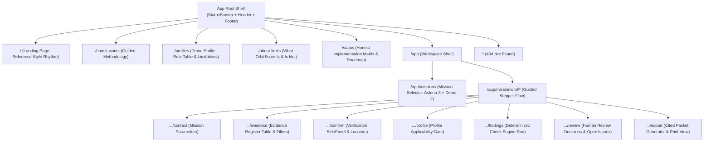

# OrbitScore Implementation Plan (`IMPLEMENTATION_PLAN.md`)

**Role**: Phase Two-A Deliverable for OrbitScore.  
**Execution Objective**: Build an evidence-preparation web application for student and smallsat teams, capturing the visual precision, obsidian-and-cyan aesthetic, and motion rhythm of EnduroSat, without cloning any intellectual property or violating honesty guardrails.

---

## 1. Page Architecture & Route Map

OrbitScore implements a multi-route single-page application using `react-router-dom` v6, cleanly dividing public explanatory pages from the mission evidence workspace.



### Route Table & Metadata

| Route Path | View / Component | Purpose & Guardrails | Title & SEO Description |
|---|---|---|---|
| `/` | `LandingPage` | Reference-inspired overview: Hero, What it is/isn't, Stepper explainer, 5-state demo, Traceability showcase, Review vs Findings split, Honest roadmap, Closing CTA. | "OrbitScore — Spacecraft Evidence Preparation Workspace" |
| `/how-it-works` | `HowItWorksPage` | Deep dive into the 6-stage evidence lifecycle and human-in-the-loop verification protocol. | "How It Works — OrbitScore Evidence Lifecycle" |
| `/profiles` | `ProfilesPage` | Specification of `demo-evidence-completeness` v0.1.0, 6 deterministic check definitions, rule table, and explicit "What it does NOT cover". | "Profiles & Rule Specs — OrbitScore" |
| `/about-limits` | `AboutLimitsPage` | Mandatory disclaimer and boundaries: OrbitScore does NOT score, certify, or approve missions; it organizes evidence for humans. | "Scope & Limitations — OrbitScore" |
| `/status` | `StatusPage` | Honest capability matrix: In-memory/local vs production backend plan; audit trail limitations; API contract preview. | "System Status & Roadmap — OrbitScore" |
| `/app` | `Navigate` | Redirects to `/app/missions`. | — |
| `/app/missions` | `MissionsListPage` | Select between Asteria-3 (synthetic CubeSat) and MicroSat-X (synthetic "Other" payload demonstrating the "Not applicable" path). | "Missions — OrbitScore Workspace" |
| `/app/missions/:id/context` | `MissionContextStep` | Step 1: Declared mission regime, team, launch window, synthetic badge. | "Mission Context — OrbitScore" |
| `/app/missions/:id/evidence` | `EvidenceRegisterStep`| Step 2: Searchable, filterable register of parameters, units, locators, and 5 states. | "Evidence Register — OrbitScore" |
| `/app/missions/:id/confirm` | `ConfirmInputsStep` | Step 3: Human confirmation panel with source citation inspection and state toggling. | "Confirm Inputs — OrbitScore" |
| `/app/missions/:id/profile` | `SelectProfileStep` | Step 4: Profile selection and applicability gate check (cubesat/smallsat vs other). | "Profile Gate — OrbitScore" |
| `/app/missions/:id/findings`| `CheckRunFindingsStep`| Step 5: Execute deterministic checks; frozen input snapshot; traceability links. | "Software Findings — OrbitScore" |
| `/app/missions/:id/review` | `HumanReviewStep` | Step 6: Reviewer decisions (`Accepted`, `Needs more evidence`, etc.) and open issues. | "Human Review — OrbitScore" |
| `/app/missions/:id/export` | `ExportPacketStep` | Step 7: Gated export packet in Markdown, JSON, and print-ready HTML. | "Export Packet — OrbitScore" |
| `*` | `NotFoundPage` | Technical 404 page styled with dark theme and return-to-base navigation. | "Page Not Found — OrbitScore" |

---

## 2. Feature Mapping Table

| My Feature | Section / Route | Reference Inspiration | Interactions & Behaviors | Needs Backend? | Automated Verification |
|---|---|---|---|---|---|
| **Persistent Honesty Banner** | All pages (fixed top) | Reference status notices & cookie bar | Displays `DEMO / MOCK`, `SYNTHETIC`, `LOCAL ONLY`. Provides "Clear local data" button. | No (client state) | Component render test & text match |
| **Top Navigation Header** | All pages (`<Header />`) | `NAV-01` (`.page_header` 3-column sticky) | Sticky on scroll down; shrinks padding; logo scales; links have text skew-flip on hover. | No | Scroll state unit test; mobile menu toggle |
| **Landing Hero & Orbital Schematic** | `/` (`HeroSection`) | `HERO-01` (`fps-hero` & 3D canvas) | Big technical typography; original SVG orbital inclination & ground track diagram; CTA button. | No | Axe contrast; snapshot test |
| **What It Is / Is Not Matrix** | `/` (`WhatItIsNotSection`) | `SEC-01` / `SEC-02` (Problem & Vision split) | Two-column high-contrast card grid contrasting honest claims against forbidden claims. | No | Forbidden wording lint test |
| **Interactive 5-State Explainer** | `/` (`EvidenceStateDemo`) | `SEC-04` ("We cover it all" cards) | Clickable state chips that toggle simulated evidence cards demonstrating each state's criteria. | No | Click interaction test |
| **Traceability Showcase** | `/` (`TraceabilityShowcase`) | `SEC-05` / `SEC-06` (Horizontal step flow) | Hover-linked interactive diagram connecting Finding ⇄ Evidence Row ⇄ Source Citation. | No | Hover state verification test |
| **Human Review vs Findings Split** | `/` (`ReviewVsFindingsShowcase`) | `SEC-03` (Two-step split panel) | Visual split highlighting software findings as deterministic inputs to independent human reviews. | No | Axe accessibility & layout check |
| **Asteria-3 Synthetic Dataset** | `/app/missions/asteria-3` | Reference satellite configurator data | Preloaded fictional 3U CubeSat featuring conflicting, missing, unconfirmed, and stale data. | No (in-memory fixture) | Fixture integrity unit tests |
| **Evidence Register Data Table** | `/app/missions/:id/evidence` | Reference technical product specs | Column sorting, text filter, state filter chips, clickable row to open side panel. | No (Zustand store) | Table sorting & filter tests |
| **Evidence Confirmation Drawer** | `/app/missions/:id/confirm` | Reference product option drawer | Slide-in drawer; citation locator display; human confirm action; timestamps. | No | Keyboard trap (`Esc`), drawer state test |
| **Deterministic Check Engine** | `/src/profiles/` module | Reference modular satellite architecture | Pure TypeScript check runner; frozen snapshot; outputs findings `C-01` through `C-06`. | No (pure functions) | 100% Vitest unit test coverage |
| **Profile Applicability Gate** | `/app/missions/:id/profile` | Reference payload compatibility filter | Evaluates `objectType`; CubeSat passes, "Other" halts with explicit "Not applicable" rationale. | No | Vitest unit test for both branches |
| **Human Review Decisions** | `/app/missions/:id/review` | Reference operational command forms | Form to record reviewer name, role, decision, comment; open issue resolution toggle. | No | Form submission & validation test |
| **Export Gating System** | `/app/missions/:id/export` | Reference checkout validation gate | Disables export button until all findings have a human decision; displays missing count. | No | Gating logic unit test |
| **Print-Ready Packet Generator** | `/app/missions/:id/export` | Reference print/datasheet view | Generates Markdown, JSON, and printable HTML with cover page, disclaimer, citations, and footer. | No (client-side export) | Export content & forbidden lint test |
| **Assisted Extraction Placeholder** | `/app/missions/:id/evidence` | Reference automated features | Clearly labeled "Planned, not implemented" mock button; opens contract documentation modal. | No | Honesty label test |

---

## 3. Animation Implementation Map

| Animation ID | Element / Component | Implementation Technique | Reduced-Motion Fallback (`prefers-reduced-motion`) | Performance Budget |
|---|---|---|---|---|
| `ANI-01` | Sticky Header hide/reveal | CSS transitions on scroll direction (`transform: translateY(-80%)`, duration `450ms`, easing `cubic-bezier(0.51, 0.01, 0.2, 1)`) | Instant class toggle (`top: 0` vs `top: -100px`), zero transition delay | GPU accelerated (`transform` only) |
| `ANI-02` | Button Skew-Slide Hover | CSS transform on dual text spans (`translateY(-200%) skewY(10deg)` with `450ms` delay) | Simple background color transition (`150ms ease`), text remains static | Zero layout reflow |
| `ANI-03` | Arrow Button Icon Motion | CSS transform on SVG elements inside icon box (`transform: translate(100%, -100%)`) | Static icon, background color shifts to cyan | Zero layout reflow |
| `ANI-04` | Scroll-Triggered Text Reveal | Framer Motion `useScroll` with `useTransform` mapping scroll progress to word opacity | Static 100% opacity for all text | Throttled scroll listener |
| `ANI-05` | Stepper Progress Transition | Framer Motion layout animation (`layoutId="stepper-active"`) with smooth cyan pill slide | Instant border switch on active step | Hardware accelerated |
| `ANI-06` | Evidence Drawer Slide-In | Framer Motion `<AnimatePresence>` with `initial={{ x: '100%' }}` and `animate={{ x: 0 }}` | Instant appearance (`display: block`), zero translate | Zero layout thrashing |
| `ANI-07` | Finding Card Highlight | Framer Motion `whileHover={{ y: -2, borderColor: '#00A1FF' }}` | Static card, border color switches on hover | Zero transform on touch devices |
| `ANI-08` | Orbital Trajectory Diagram | Original SVG with CSS dasharray stroke animation simulating orbital satellite motion | Static continuous SVG orbital ellipse without animation | SVG vector only, zero WebGL overhead |
| `ANI-09` | State Badge Pulsing Indicator | CSS `@keyframes pulse` on active unconfirmed/conflicting dot (`opacity: 0.6` to `1.0`) | Solid static dot without pulsing | Low CPU consumption |
| `ANI-10` | Export Packet Download Alert | Framer Motion toast alert slide down from top (`y: -20` to `y: 0`, duration `200ms`) | Instant toast rendering | Removed after 3000ms |

---

## 4. Proposed File & Folder Structure

```
/Users/narayanjha/Documents/Git-Projects/HaX26/PhantomDeps/OrbitScore/
├── orbitscore_master_prompt_v2.md   # Master specification
├── REFERENCE_ANALYSIS.md            # Phase One reference analysis
├── DESIGN_SYSTEM.md                 # Phase Two-A design system tokens
├── IMPLEMENTATION_PLAN.md           # Phase Two-A implementation blueprint
├── ASSUMPTIONS.md                   # Architectural and product defaults
├── PROGRESS.md                      # Live checkpoint log
├── ASSETS.md                        # Original asset licenses and sources
├── PROFILE_SPEC.md                  # Demo profile and check definitions
├── openapi.draft.yaml               # Future FastAPI production schema
├── docs/
│   └── reference/
│       └── screenshots/             # Reference screenshots
└── app/                             # Frontend application directory
    ├── package.json                 # React 18, Vite, TypeScript, Zustand, Vitest, Playwright
    ├── tsconfig.json                # TypeScript strict configuration
    ├── vite.config.ts               # Vite configuration with chunk splitting
    ├── vitest.config.ts             # Unit test runner config
    ├── playwright.config.ts         # End-to-end test config
    ├── index.html                   # HTML entry point with preload tags
    ├── public/
    │   ├── fonts/                   # Self-hosted Space Grotesk, Inter, JetBrains Mono
    │   └── favicon.svg              # Original OrbitScore vector mark
    └── src/
        ├── main.tsx                 # React DOM root entry
        ├── App.tsx                  # App shell & router declaration
        ├── styles/
        │   ├── tokens.css           # CSS custom properties (colors, typography, spacing)
        │   ├── global.css           # Global resets, typography defaults, accessibility
        │   └── print.css            # Print-to-PDF stylesheet for export packets
        ├── types/
        │   ├── domain.ts            # Mission, EvidenceItem, Profile, CheckRun, Finding, ReviewDecision
        │   └── api.ts               # API adapter interfaces
        ├── profiles/
        │   ├── demo-evidence-completeness.ts # 6 deterministic checks (pure functions)
        │   └── demo-evidence-completeness.test.ts # 100% unit test coverage
        ├── fixtures/
        │   ├── asteria-3.ts         # Synthetic 3U CubeSat dataset (conflicting, missing, etc.)
        │   └── microsat-x.ts        # Synthetic "Other" mission (demonstrating Not Applicable)
        ├── store/
        │   ├── useOrbitStore.ts     # Zustand store with persistence & reset logic
        │   └── useOrbitStore.test.ts
        ├── api/
        │   ├── client.ts            # ApiClient interface
        │   ├── mockAdapter.ts       # Active local in-memory adapter
        │   └── httpAdapterStub.ts   # Stub for future FastAPI backend
        ├── components/
        │   ├── common/
        │   │   ├── Header.tsx & .module.css
        │   │   ├── Footer.tsx & .module.css
        │   │   ├── StatusBanner.tsx & .module.css
        │   │   ├── Button.tsx & .module.css
        │   │   ├── StateChip.tsx & .module.css
        │   │   ├── StatusBadge.tsx & .module.css
        │   │   ├── Stepper.tsx & .module.css
        │   │   ├── SidePanel.tsx & .module.css
        │   │   ├── Dialog.tsx & .module.css
        │   │   └── Tooltip.tsx & .module.css
        │   ├── visual/
        │   │   ├── OrbitalDiagram.tsx & .module.css # Original SVG orbital track
        │   │   └── GroundStationMap.tsx & .module.css
        │   └── workspace/
        │       ├── DataTable.tsx & .module.css
        │       ├── FindingCard.tsx & .module.css
        │       ├── ReviewDecisionForm.tsx & .module.css
        │       ├── OpenIssuesList.tsx & .module.css
        │       └── ExportPreview.tsx & .module.css
        ├── pages/
        │   ├── LandingPage.tsx & .module.css
        │   ├── HowItWorksPage.tsx & .module.css
        │   ├── ProfilesPage.tsx & .module.css
        │   ├── AboutLimitsPage.tsx & .module.css
        │   ├── StatusPage.tsx & .module.css
        │   ├── MissionsListPage.tsx & .module.css
        │   ├── MissionWorkspacePage.tsx & .module.css # Houses steps 1-7
        │   └── NotFoundPage.tsx & .module.css
        └── test/
            ├── banned-words-lint.test.ts # Lints copy for forbidden claims / scores
            ├── full-flow.test.tsx        # Integration test for Asteria-3 lifecycle
            └── a11y.test.tsx             # axe-core automated audit
```

---

## 5. State Management Architecture

**Zustand** is chosen for OrbitScore's client state management for three foundational reasons:
1. **Fine-Grained Selector Reactivity**: The Evidence Register contains dense tables of parameters, citations, and locators. With Zustand selectors (`useOrbitStore(state => state.evidence)`), updating a single evidence item's verification status re-renders only that specific row, preventing expensive full-table re-renders.
2. **Deterministic Snapshot & Re-run Integrity**: When running checks, the state engine captures an immutable frozen snapshot of `EvidenceItem[]`. If upstream evidence is subsequently edited, a computed selector immediately flags downstream findings as **`stale: true`**, warning the reviewer.
3. **Transparent Persistence & Single-Action Reset**: Zustand provides a clean persistence middleware for `localStorage` (`orbitscore_state_v1`). Resetting the demo back to the clean synthetic Asteria-3 state requires a single pure action (`resetDemo()`), fulfilling §4.4.

---

## 6. Build Sequence in Vertical Slices

Each vertical slice produces a runnable, testable increment before the next slice begins:

### Slice 1: Scaffold, Tooling & Design System Foundation
- Initialize Vite + React 18 + TypeScript strict in `/app`.
- Configure ESLint, Prettier, Vitest, and axe-core.
- Implement `tokens.css`, `global.css`, self-hosted web fonts, and the skip-to-content landmark.
- Quality Gate: `npm run build` passes; global styles render cleanly.

### Slice 2: Layout Shell & Honest Status System
- Build persistent `StatusBanner` with `DEMO / MOCK`, `SYNTHETIC`, and `LOCAL ONLY` badges.
- Build sticky `Header` with logo, navigation links, and mobile drawer.
- Build `Footer` with legal disclaimers and limitations statement.
- Quality Gate: Keyboard navigation and mobile hamburger drawer operate cleanly.

### Slice 3: Domain Types, Pure Check Engine & Unit Tests
- Define complete TypeScript types (`Mission`, `EvidenceItem`, `Profile`, `CheckRun`, `Finding`, `ReviewDecision`).
- Implement the 6 deterministic checks in `/src/profiles/demo-evidence-completeness.ts`:
  - `C-01`: Required parameters present (mass, dimensions, orbit regime, deployment date, contact document).
  - `C-02`: Units valid per parameter allowed unit list.
  - `C-03`: Cross-source consistency within declared tolerance.
  - `C-04`: Source traceability (document title + locator page/section).
  - `C-05`: Version/date currency against mission reference date.
  - `C-06`: Confirmation status of required inputs.
- Quality Gate: 100% Vitest unit tests green for all checks, conflict conditions, and edge cases.

### Slice 4: Synthetic Asteria-3 Fixtures, Store & Reset
- Construct the Asteria-3 synthetic 3U CubeSat fixture containing:
  - Conflicting mass (3.9 kg in Mission Overview vs. 4.3 kg in Mass Budget).
  - Missing deployment date.
  - Unconfirmed battery energy from informal slide deck.
  - Out-of-scope propulsion item.
  - Stale document dated prior to reference threshold.
  - Several fully confirmed items with primary citations.
- Construct the MicroSat-X fixture with `objectType: 'other'` to test the "Not applicable" path.
- Implement Zustand store with optional `localStorage` and `resetDemo()` action.
- Quality Gate: Store actions and fixture loading unit-tested.

### Slice 5: Workspace Flow: Context, Evidence Register & Confirmation
- Build Step 1 (`MissionContextStep`): Displays declared parameters, team, launch window, synthetic notice.
- Build Step 2 (`EvidenceRegisterStep`): Searchable, filterable table with 5 distinct `StateChip` indicators.
- Build Step 3 (`ConfirmInputsStep` & `SidePanel`): Slide-in verification drawer with locator details and reviewer confirmation inputs.
- Quality Gate: Row click opens drawer; confirming updates state and marks findings stale.

### Slice 6: Profile Selection, Check Execution & Findings View
- Build Step 4 (`SelectProfileStep`): Displays demo profile details, rules, limitations, and applicability gate.
- Build Step 5 (`CheckRunFindingsStep`): Executes pure check runner; captures frozen input snapshot; renders `FindingCard` items with bidirectional traceability links back to evidence rows.
- Quality Gate: Profile applicability gating halts "Other" missions; check run generates exact expected findings.

### Slice 7: Human Review Decisions, Open Issues & Export Gating
- Build Step 6 (`HumanReviewStep`): Standalone review cards allowing reviewers to author decisions (`Accepted for packet`, `Needs more evidence`, etc.) with role and comment.
- Implement open issue tracker.
- Build Step 7 (`ExportPacketStep`): Implements the mandatory export gate. If any finding lacks a human review, the export button is visibly disabled with an explanation.
- Quality Gate: Export button unlocks only when 100% of findings have a human review.

### Slice 8: Cited Export Packet Generator & Print Stylesheet
- Implement client-side export generation for Markdown (.md), JSON (.json), and Print HTML.
- Include all required sections: Cover, SYNTHETIC tag, limitations disclaimer, evidence register with citations, frozen check run inputs, software findings, human review decisions, open issues, and source index.
- Implement `@media print` stylesheet with black-on-white high contrast, no navigation bars, and page break controls.
- Quality Gate: Generated export contains required footer and disclaimer on every page.

### Slice 9: Reference-Inspired Landing Page & Motion Layer
- Build public `/` landing page matching the EnduroSat rhythm:
  - Header → Hero with technical typography and orbital SVG diagram → What it is / is not → Workflow stepper → Interactive 5-state demo → Traceability showcase → Review vs Findings split → Honest status/roadmap → Closing CTA → Footer.
- Apply CSS and Framer Motion micro-interactions (button text skew-slide, hover glows, scroll reveals).
- Ensure `prefers-reduced-motion` cleanly replaces all animations with static layouts.
- Quality Gate: No layout shifts; Lighthouse mobile score `>= 90`.

### Slice 10: Validation Gates, Forbidden Word Lint & Final Documentation
- Run automated banned-wording lint over `/src` and export outputs to guarantee zero prohibited words (`certified`, `compliant`, `approved`, `score of`, `pass/fail`, etc.).
- Run axe-core accessibility audit across all routes with zero critical/serious violations.
- Verify zero horizontal overflow at 1920px, 1440px, 1024px, 768px, and 390px.
- Write `VALIDATION_REPORT.md` and update `PROGRESS.md`.
- Quality Gate: All gates green.

---

## 7. Risk Analysis & Mitigation Strategies

| Identified Risk | Severity | Potential Impact | Concrete Mitigation Strategy |
|---|---|---|---|
| **Accidental "Certification" or "Score" Language** | Critical | Regulatory & legal misrepresentation of product capabilities | Automated Vitest lint scanning all text strings in `/src` and export outputs for banned words. Pre-commit check fails if violations occur. |
| **A11y Contrast Degradation on Dark Theme** | High | Fails WCAG 2.2 AA; unreadable for low-vision users | All text colors mathematically chosen for `>= 4.5:1` contrast against dark surfaces. Automated axe-core unit tests in CI. |
| **Scroll-Jank or Disorientation from Motion** | Medium | User motion sickness, poor Core Web Vitals | Zero continuous WebGL render loop on critical path; lightweight SVG/CSS transforms; full `prefers-reduced-motion` override. |
| **Misunderstanding of Client-Only Persistence** | Medium | User expects persistent cloud sync across devices | Prominent top banner and export disclaimer declaring that data is stored in browser memory/localStorage only. |
| **Complex Traceability Gaps** | Medium | Reviewers cannot locate primary source for a finding | Every `EvidenceItem` requires document title + locator page/section, enforced by check `C-04`. |
