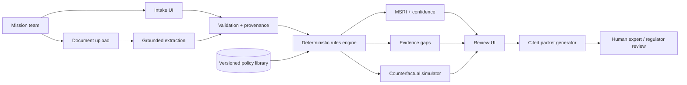
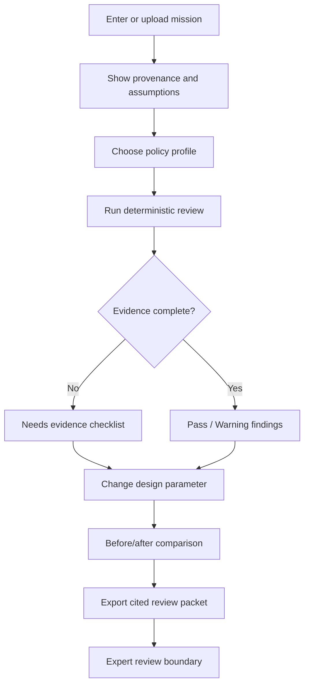
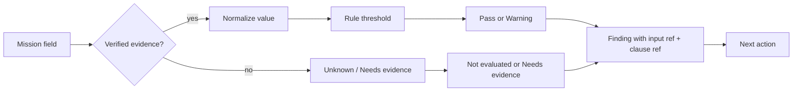
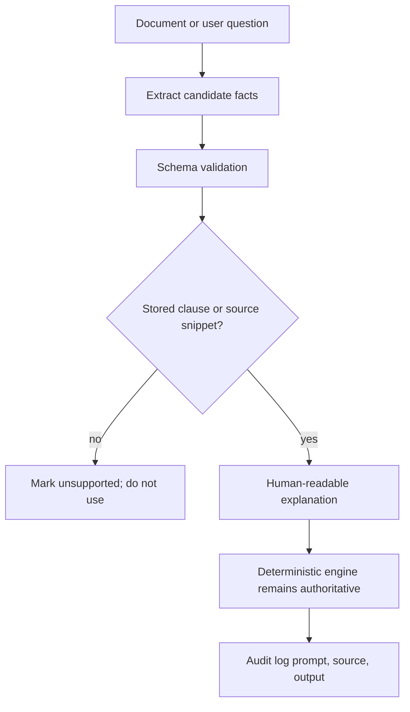
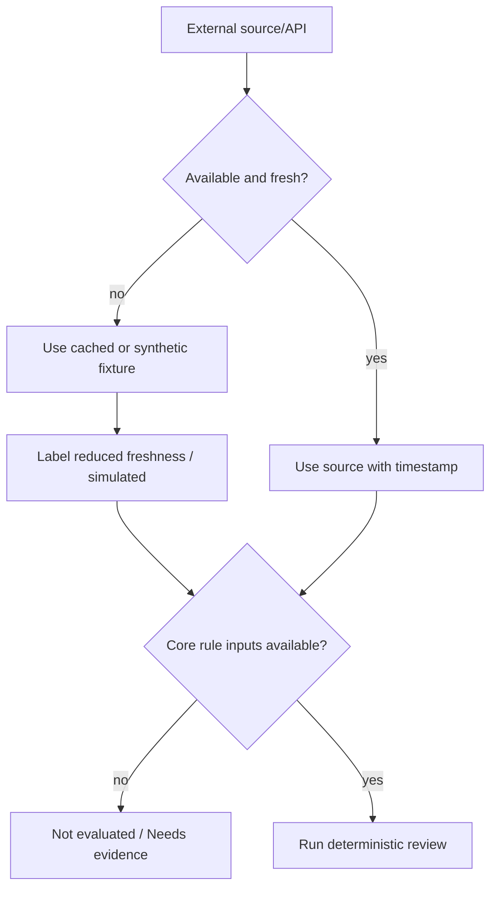
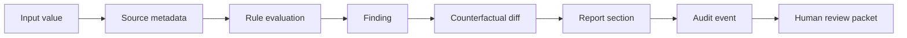

# OrbitReady — Hackyard Build 2026 Research, Validation, and Winning Build Design

**Decision:** Build **OrbitReady**, an evidence-first Mission Sustainability Readiness Copilot. Do not build a collision-warning dashboard, a universal compliance certificate, or a replacement for NASA Debris Assessment Software (DAS).

OrbitReady turns a mission profile and supporting evidence into a transparent pre-review: deterministic policy checks, missing-evidence findings, a cautious readiness index, a live before/after comparison, and a cited review packet. Its safety boundary is deliberate: it organizes evidence before expert or regulatory review; it does not certify a mission or make operational conjunction decisions.

## 1. Official Hackyard verification

The official Hackyard Build 2026 site describes a free, open application period from 14 September to 10 October 2026 and a 24-hour in-person build at IIT Guwahati on 24–25 October 2026. Teams may build solo or with 2–4 people, with a maximum team size of four. [1] [2]

The official guide says there is no assigned theme and that builders should start with an idea, problem, or skill. It explicitly asks teams to make the smallest version that works, test it with realistic and awkward inputs, explain failures, use synthetic, public, or authorized data, and show what the product does rather than only describing it. [2]

The jury weights are **Build 40%, Problem 20%, Ingenuity 20%, Potential 20%**. “Build” asks whether the core experience actually works; “Problem” asks whether it solves a real or meaningful problem; “Ingenuity” asks whether the approach is clever, original, or thoughtful; and “Potential” asks whether there is a reason to keep building after the event. [1] [2]

### Strategy implied by the rubric

- **Build:** ship one complete flow from intake to review to export. A polished map without a reproducible review is weaker.
- **Problem:** show the evidence bottleneck faced by a small satellite or university team before expert review.
- **Ingenuity:** make every finding traceable to an input, source clause, reasoning step, limitation, and corrective action. Then change one design parameter live.
- **Potential:** show a credible path to versioned jurisdiction profiles, authorized document connectors, expert review, and policy-change monitoring.

**Confirmed:** event dates, location, team-size rules, the four judging weights, and the guide’s emphasis on working software and awkward test cases are supported by official Hackyard pages. [1] [2]

**Inference:** OrbitReady is a strong fit because its value can be shown in three minutes without depending on a live orbital-data feed. That fit is an inference from the rubric, not a statement by Hackyard.

## 2. Problem archaeology

### Primary user and trigger

The primary user is a small satellite startup, university mission team, or systems engineer preparing an internal design review or an expert/regulatory conversation. The trigger is a mission milestone: preliminary design review, launch-provider questionnaire, licensing preparation, a change in orbit or mission duration, or a request from an advisor to show debris-mitigation evidence.

### Current workflow

1. The team collects mission facts from systems documents, spreadsheets, and engineering conversations.
2. A lead engineer manually maps those facts to agency guidance, customer questions, or internal checklists.
3. Missing proof is discovered late, often after a design choice is expensive to change.
4. A specialist performs a deeper assessment using authoritative tools and data.
5. The team revises the design and regenerates evidence for review.

The painful part is not simply calculating an orbital quantity. It is connecting a changing mission design to the exact proof a reviewer will expect, while preserving source, date, ownership, assumptions, and unresolved gaps.

### Biggest bottleneck

**Evidence readiness is the bottleneck:** teams may have a plausible design but cannot quickly answer “which requirement does this satisfy, where is the evidence, how current is it, and what changes if we alter the disposal plan?”

### Failure points and OrbitReady’s response

| Failure point | OrbitReady response | Safe behavior |
|---|---|---|
| Mission facts are scattered | Structured intake plus document-fact capture | Preserve provenance per value |
| Requirement wording is ambiguous | Versioned policy clauses with plain-language interpretation | Show source and scope |
| Proof is absent | Evidence checklist and owner/next-action field | Return **Needs evidence**, never Pass |
| Inputs conflict | Conflict banner and side-by-side values | Do not silently select one |
| Public orbital data is stale or unavailable | Cached/synthetic demo fallback | Show source, epoch, age, and label |
| User changes a design parameter | Deterministic counterfactual re-run | Explain which findings changed and why |
| AI produces an unsupported statement | Grounded explanation constrained to stored clauses | Mark unsupported output as unusable |
| Reviewer needs an audit trail | Cited Markdown/HTML packet | Include assumptions and disclaimer |

### Why a small operator first

A large operator may already have analysts, compliance processes, ephemeris pipelines, and specialized tools. A small operator has a larger evidence-organization gap and benefits from a narrow, transparent workflow. This is an **inference** about product wedge and should be tested with interviews; it is not a claim that large operators lack the problem.

## 3. Domain and policy findings

### NASA DAS defines the formal-assessment boundary

NASA says DAS assesses compliance of spacecraft, upper stages, and payloads with requirements covering debris generation, spacecraft vulnerability, postmission lifetime, and entry safety. NASA also says successful verification in DAS demonstrates compliance with NASA debris-mitigation requirements. The current NASA page identifies DAS 3.2.7 and notes that some reliability facets are not addressed by DAS. Acquiring the software requires a Software Usage Agreement. [3]

**Product implication:** OrbitReady should position itself as a **pre-review and evidence-readiness layer**. It should help teams structure inputs, identify missing proof, compare design choices, and prepare a packet before expert use of DAS or another authoritative process. It must not claim to replace DAS.

### India is a credible wedge, not an endorsement

ISRO’s April 2024 statement says India intends to achieve debris-free space missions by all Indian governmental and non-governmental space actors by 2030. The statement includes avoiding debris generation, avoiding on-orbit collision and breakup, preventing intentional breakups with long-lived debris, and achieving post-mission disposal success probability above 99%, with controlled re-entry or de-orbiting to an orbit with less than five years of remaining orbital life for rocket bodies and spacecraft at end of operational life. It also emphasizes trackability, identifiability, maneuverability, coordination, and data sharing. [4]

**Product implication:** an India DFSM-inspired profile is useful for a demo. Every rule must carry its source URL, publication/update date, scope, and a status of **Verified source**, **Team interpretation**, or **Prototype assumption**. OrbitReady must not claim ISRO, IN-SPACe, or regulator endorsement.

### International guidance

The prototype may cite intergovernmental debris-mitigation guidance as background, but it should avoid pretending that one universal template is accepted by every regulator. Jurisdiction-specific profiles should be versioned and scoped. The MVP can begin with:

- **India DFSM-inspired:** public ISRO intent and clearly marked interpretation.
- **NASA-inspired:** public NASA debris-mitigation concepts and DAS boundary.
- **Internal review:** neutral checklist used to demonstrate the workflow without claiming legal applicability.

## 4. Data audit and safety boundary

Space-Track’s documentation warns that a publicly available TLE should not be used for conjunction-assessment prediction for operational satellites. The same documentation distinguishes public catalog access from operator-facing conjunction services and says collision avoidance remains the satellite owner/operator’s responsibility. [5]

OrbitReady therefore does **not** calculate collision probability, miss distance, maneuver advice, or operational conjunction alerts from public TLEs. If an educational orbital visualization is added later, the UI must show data source, epoch, age, confidence, and a visible label such as “educational / historical / non-operational.”

### What can be real in the MVP

- Mission intake validation.
- Versioned policy rules and source citations.
- Deterministic Pass / Warning / Needs evidence / Not evaluated states.
- Score calculation and confidence logic.
- Evidence provenance and audit log.
- Before/after counterfactual comparison.
- Markdown/HTML packet export.
- Hand-checked seeded cases and tests.

### What may be simulated or cached

- Seeded mission profiles.
- Policy rule fixtures.
- Document-extraction examples.
- A small historical or educational orbital dataset.
- An unavailable external API.

Every simulated, cached, or synthetic item must be labeled in the product and in the report.

### AI boundary

AI may extract facts from an uploaded document, map a sentence to a stored requirement, explain a deterministic finding, draft a review note, and ask for clarification when values conflict. AI must not invent a policy rule, decide Pass/Warning, calculate MSRI, or convert missing data into a positive result. This separation aligns with the general direction of the NIST AI Risk Management Framework, which is intended to improve the incorporation of trustworthiness considerations into AI design, development, use, and evaluation. [8]

## 5. Existing-solution landscape and whitespace

| Category | What exists | Why OrbitReady is not the same |
|---|---|---|
| NASA DAS | Specialized debris assessment against NASA requirements | OrbitReady prepares inputs and evidence earlier; it is not a replacement |
| Government/operator CA services | Authoritative tracking, close-approach notifications, and operator workflows | OrbitReady avoids operational CA and focuses on design-review readiness |
| Commercial orbital intelligence | LeoLabs markets persistent orbital intelligence, space-domain awareness, space-traffic management, launch and operations support, radar, and AI-enabled alerts. [6] | OrbitReady is a small-operator evidence workflow, not a sensor/catalog business |
| Collision-avoidance collaboration | Slingshot Beacon describes operator coordination, alerts, maneuver communication, CDMs, and ephemeris sharing. [7] | OrbitReady addresses pre-launch or pre-expert-review design evidence, not live coordination |
| Generic compliance software | Checklists and document repositories | OrbitReady links the exact input, policy clause, reasoning, limitation, and counterfactual effect |

**Whitespace:** an inspectable layer between early mission design and formal expert/regulatory review. The differentiator is not “AI for space.” It is the evidence-linked counterfactual loop.

## 6. Candidate framing comparison

| Framing | Build feasibility | Differentiation | Evidence risk | Decision |
|---|---:|---:|---:|---|
| Space Credit Score | Low | Low–medium | High: false precision and unclear validity | Reject |
| Live collision predictor | Low | Low in a crowded market | Very high: authoritative data and safety claims | Reject |
| Universal compliance platform | Low | Medium | High: jurisdiction and legal scope | Reject |
| Mission Sustainability Readiness Copilot | High | High for a 24-hour build | Controlled if sources and limits are explicit | **Select** |

## 7. Capability inventory and top-five selection

### Candidate capabilities

1. Mission-document fact extraction.
2. Policy-to-mission mapping.
3. Evidence completeness detection.
4. Conflicting-value detection.
5. Explainable Pass / Warning / Needs evidence / Not evaluated states.
6. Counterfactual disposal comparison.
7. Policy-profile switching.
8. Source and version provenance.
9. Uncertainty-aware recommendations.
10. Expert-escalation packet generation.
11. Cached-data fallback.
12. Audit-log reconstruction.
13. Mission-parameter sensitivity.
14. Design-to-evidence traceability.
15. Review history and change comparison.

### Top five for the event

1. **Deterministic evidence review:** the core value and strongest Build proof.
2. **Evidence-linked counterfactual:** the memorable Ingenuity moment.
3. **Provenance and source clauses:** the trust and safety boundary.
4. **Safe incomplete-data behavior:** demonstrates mature handling of awkward cases.
5. **Cited packet export:** closes the workflow and supports Potential.

Document extraction can be a thin optional layer. If it threatens reliability, the MVP should use structured input plus one seeded document example rather than fail the core flow.

## 8. Technical feasibility and stack

Use a monolith for the hackathon:

- **Frontend:** React or Next.js with Intake, Review, and Export views.
- **Backend:** FastAPI or a small server route layer for validation, rules, scoring, and report generation.
- **Rules:** JSON/YAML with `id`, `profile`, `version`, `source_url`, `source_title`, `scope`, `threshold`, `required_evidence`, `interpretation`, and `status`.
- **Storage:** SQLite or local JSON for the prototype.
- **AI:** one grounded structured-output call, optional and isolated from the deterministic evaluator.
- **Reports:** Markdown/HTML first; PDF only after the core flow works.
- **Testing:** unit tests for each rule, boundaries, missing data, conflicts, stale data, API failure, counterfactuals, and unsupported claims.

### Minimal data model

```text
Mission
  id, name, source_type, source_timestamp, values, assumptions

EvidenceItem
  id, mission_id, field, value, source_excerpt, source_url, status, owner

PolicyProfile
  id, name, jurisdiction_scope, version, disclaimer

PolicyRule
  id, profile_id, clause, source_url, threshold, required_fields, interpretation_status

Finding
  rule_id, state, input_refs, evidence_refs, reasoning, limitation, next_action

Review
  mission_id, profile_id, msri, confidence, findings, created_at, parent_review_id
```

## 9. Architecture diagrams

### High-level architecture



### User flow



### Evidence and rule flow



### AI guardrail flow



### Fallback and failure flow



### Audit and logging flow



## 10. MVP contract

### Must be real

- Intake fields for altitude/orbit type, mass, duration, disposal plan or remaining lifetime, trackability, maneuverability, and breakup-prevention evidence.
- At least three profiles: India DFSM-inspired, NASA-inspired, and neutral internal review.
- Deterministic statuses: Pass, Warning, Needs evidence, Not evaluated.
- MSRI as a decision-support index, with component breakdown and confidence.
- Missing-evidence checklist.
- One before/after counterfactual.
- Cited report export with assumptions, sources, and disclaimer.
- Seeded awkward case where incomplete data prevents overclaiming.

### May be mocked, cached, or synthetic

- Document extraction.
- Historical orbital visualization.
- External API failure.
- Seeded mission data.

### Deferred

- Multi-tenant accounts.
- Regulatory submission integrations.
- Live conjunction assessment.
- Full NASA DAS interoperability.
- Model training or vector database.
- Universal jurisdiction coverage.

### UI disclaimer

> OrbitReady is a pre-review and evidence-readiness tool. It is not an official regulatory filing, certification, collision-avoidance service, safety-grade conjunction-assessment system, or replacement for NASA Debris Assessment Software or qualified expert review. Synthetic, cached, and interpreted values are labeled.

## 11. MSRI design and limitations

Call the score the **Mission Sustainability Readiness Index (MSRI)**. It is a prioritization aid, not a probability, regulator decision, insurance rating, or safety guarantee.

```text
MSRI = 100 × (0.30 × evidence_completeness
            + 0.25 × disposal_readiness
            + 0.20 × trackability_and_identifiability
            + 0.15 × maneuverability_and_collision_preparedness
            + 0.10 × breakup_prevention_evidence)
            − critical_gap_penalty
```

Use coarse bands:

- **Ready for expert review**
- **Review gaps first**
- **Insufficient evidence**

Rules for implementation:

- Missing values are `Unknown`, not an implicit zero or pass.
- A critical gap can cap the score.
- Confidence is shown separately as High, Medium, or Low.
- Show component evidence and the exact source clause.
- Avoid decimals that imply scientific precision.
- Weights are prototype assumptions and must be visible.

The score is useful because it prioritizes work. It is not scientifically validated in the MVP. Validation is instead against hand-checked fixtures, boundary tests, and reproducible before/after behavior.

## 12. Validation and failure plan

| Test | Expected result |
|---|---|
| Hand-checked India fixture | Known rule states and source links match expected output |
| Disposal boundary value | Exactly five years behaves according to the configured rule and is documented |
| Missing disposal evidence | Needs evidence or Not evaluated; never Pass |
| Missing trackability evidence | Needs evidence and reduced confidence |
| Conflicting documents | Conflict banner; no silent merge |
| Stale external data | Freshness warning and reduced confidence |
| API unavailable | Cached/synthetic fallback with visible label |
| Counterfactual improvement | Same inputs except one controlled change; reproducible delta |
| Unsupported AI claim | Rejected or marked unsupported |
| Export audit | Packet contains sources, assumptions, findings, limitations, and next actions |

### 72-hour go/no-go test

**Pass** if one authoritative clause can be cited, one mission can be evaluated deterministically, one structured input produces evidence-linked findings, one missing input produces a safe non-pass, one design change produces a repeatable before/after, and one packet exports.

**Warning** if the core workflow works but an optional AI or data dependency is unstable. Remove the dependency from the main demo.

**Fail** if the product depends on inaccessible data or cannot reproduce the same review from the same inputs. Narrow the scope immediately; do not add infrastructure.

## 13. Demo strategy

### 30 seconds

Show the seeded mission and say: “OrbitReady does not predict collisions. It answers the earlier question: is our debris-mitigation evidence ready for serious review?” Click Review and show a non-pass finding.

### 60 seconds

Enter the mission, choose India DFSM-inspired profile, show the score, confidence, and three evidence gaps. Expand one result to show input, source clause, reasoning, limitation, and next action.

### 3 minutes

1. State the evidence bottleneck.
2. Load the seeded awkward mission.
3. Run the review.
4. Show Pass, Warning, Needs evidence, and Not evaluated behavior.
5. Change disposal lifetime or add maneuverability evidence.
6. Show the before/after difference.
7. Remove a required field to demonstrate safe refusal.
8. Export the cited packet.

Memorable line: “The result changed because the evidence changed, not because a chatbot wrote a nicer paragraph.”

### 5 minutes

Add the architecture and safety boundary, explain why the rules engine is deterministic, show policy-profile switching, show the cached-data label, and answer why this is complementary to NASA DAS and operational services.

## 14. Hostile judge questions and answers

1. **What exactly is novel?** The evidence-linked counterfactual loop: input, clause, reasoning, uncertainty, corrective action, and before/after effect in one workflow.
2. **Why does this need AI?** AI is optional leverage for extraction and explanation. It never decides the safety result.
3. **Why not NASA DAS?** DAS performs a specialized assessment. OrbitReady prepares evidence and design-review inputs earlier.
4. **Are you predicting collisions?** No. Public TLEs are not used for operational conjunction prediction. [5]
5. **Is this an official compliance tool?** No. It is pre-review software and says so in the UI and export.
6. **Are you claiming ISRO alignment?** No endorsement is claimed. The India profile is derived from public ISRO material and labels interpretation separately. [4]
7. **Can the score be trusted?** It is a transparent prioritization index, not a scientific probability. Inputs, weights, confidence, and limitations are visible.
8. **How are weights justified?** They are prototype assumptions, not validated science. The value is repeatable prioritization, followed by expert review.
9. **What happens when data is missing?** The state becomes Needs evidence or Not evaluated; it never becomes Pass.
10. **What happens when sources conflict?** The product preserves both values, marks a conflict, and requests resolution.
11. **What happens if an API fails?** The review continues with labeled cached or synthetic data, or returns Not evaluated if the core input is unavailable.
12. **What happens if data is stale?** Freshness is shown and confidence is reduced; stale data cannot silently produce operational advice.
13. **What if the model hallucinates?** The model only receives stored clauses and snippets; unsupported claims are rejected or marked unsupported.
14. **Why not use a commercial orbital-intelligence platform?** Those products serve operational awareness and coordination. OrbitReady serves evidence readiness before that stage. [6] [7]
15. **Who uses this next week?** A systems engineer preparing an internal review or an expert conversation.
16. **What measurable benefit exists?** The MVP demonstrates conversion of an unstructured checklist into a reproducible evidence packet and identifies the design change that removes a gap. Time savings require user study.
17. **What is the biggest limitation?** It does not replace authoritative tracking, agency software, or expert review.
18. **What part is copied easily?** A dashboard. The defensibility is the versioned rule library, provenance model, fixtures, and review history.
19. **What is the moat?** Reproducible safe behavior, policy versioning, and an anonymized corpus of authorized review patterns.
20. **What happens outside tested cases?** The product narrows output to Not evaluated or requests expert escalation.
21. **Is this research or engineering?** The MVP is engineering around evidence workflow; scientific validity of the score is explicitly not claimed.
22. **What is the smallest paid version?** A team workspace for versioned mission evidence, expert review, and jurisdiction profiles.
23. **What would an expert reject?** Unsupported interpretation, stale source, hidden assumptions, or a claim that the packet is an official filing. The UI is designed to expose those limits.
24. **How does it scale?** Add policy profiles and connectors after the monolith is validated; do not start with microservices.
25. **Why should judges remember it?** A missing disposal input is fixed, the readiness band changes live, and the exact cited reason is exported.
26. **Why India first?** ISRO’s public 2030 debris-free mission intent creates a timely local wedge. [4]
27. **What if AI is unavailable?** Intake, rules, scoring, counterfactuals, and export still work without AI.
28. **What if the team cannot access NASA DAS?** OrbitReady does not depend on DAS; it clearly labels itself complementary and links the official DAS page.
29. **Does the report certify safety?** No. It is a cited internal review packet.
30. **What will you build after the event?** Versioned jurisdiction profiles, authorized document connectors, expert sign-off, policy-change monitoring, and validated links to professional analysis tools.

## 15. Final recommendation

Build OrbitReady because it matches the event’s strongest signal: a small working product that solves one real workflow and handles awkward inputs honestly. The user is a small mission team that needs a defensible review before spending expert time or committing to a design. The timing is credible because debris-mitigation expectations are explicit in NASA practice and India has publicly stated a 2030 debris-free mission intent. The project is feasible in 24 hours because its core is deterministic and can run on seeded, cached, or synthetic data.

Do not build the alternatives. Live collision prediction requires authoritative data, validation, and operational responsibility that the event prototype cannot safely provide. A universal score creates false precision. A generic dashboard competes directly with better-funded orbital-intelligence platforms.

The real bottleneck is fragmented evidence. The genuine innovation is not an invented space score; it is the inspectable connection between design choice, source clause, missing proof, uncertainty, corrective action, and counterfactual result. Judges should remember the moment when one missing disposal input is fixed, the readiness result changes, and the system exports the exact reason.

## 16. Copy-ready Hackyard submission text

### Problem Statement

Small satellite teams must make debris-mitigation and post-mission decisions early, but the evidence needed for a serious review is scattered across mission documents, engineering assumptions, and jurisdiction-specific guidance. Existing professional tools and operational services are valuable but can be difficult for a small team to use during early design review. The result is a preventable evidence bottleneck: teams may not know which requirements they satisfy, which proof is missing, or which design change would improve their sustainability posture. Public orbital data also has important limitations and should not be presented as safety-grade conjunction prediction.

### Proposed Solution

OrbitReady is an evidence-first Mission Sustainability Readiness Copilot. A user enters or uploads a mission profile, selects a transparent policy profile, and receives an explainable review of debris-mitigation readiness. A deterministic rules engine evaluates the available evidence, labels gaps and unknowns, and calculates a cautious readiness index. A grounded AI assistant can extract facts, explain findings, and draft a cited review packet without making the final safety decision. Users can change a mission parameter and immediately see the evidence-linked effect on readiness.

### Key Features

- Mission intake for orbit, mission duration, disposal, trackability, maneuverability, and breakup-prevention evidence.
- Versioned NASA-inspired, India DFSM-inspired, and neutral internal-review profiles.
- Deterministic Pass, Warning, Needs Evidence, and Not Evaluated results.
- Mission Sustainability Readiness Index with component breakdown and confidence.
- Evidence provenance linking every finding to an input and source clause.
- Counterfactual design comparison showing how a changed disposal or mission parameter affects readiness.
- Grounded AI extraction and explanation with no unsupported compliance claims.
- Cited exportable review packet with assumptions, limitations, and next actions.
- Explicit safe behavior for missing data, API failure, and unsupported operational claims.

### Technology & Tech Stack

React/Next.js frontend; Python FastAPI backend; SQLite for the prototype; a versioned JSON/YAML rules library; deterministic Python validation and scoring; an optional grounded structured-output LLM for extraction and explanations; Markdown/HTML report generation; and unit tests covering thresholds, missing inputs, source provenance, and counterfactual cases. Any orbital data used in the demo is labeled as educational, cached, or synthetic and is not used for operational conjunction assessment.

### Innovation & Differentiation

OrbitReady does not claim to be another global collision-warning dashboard or an official compliance authority. Its core innovation is an evidence-linked counterfactual review loop for small satellite teams: every result shows the mission input, the source rule, the reasoning, the uncertainty, the missing proof, and the design change that could improve readiness. AI is constrained to extraction and explanation, while deterministic rules produce the decision state. This makes the product demonstrable in 24 hours, safer to trust, and extensible into jurisdiction-specific review workflows.

## References

[1]: https://hackyard.org/build2026 "Hackyard Build 2026 official overview"

[2]: https://hackyard.org/build2026/guide "Project & Participant Guide | Hackyard Build 2026"

[3]: https://orbitaldebris.jsc.nasa.gov/mitigation/debris-assessment-software.html "NASA Debris Assessment Software"

[4]: https://www.isro.gov.in/Debris_Free_Space_Missions.html "India’s Intent on Debris-Free Space Missions - Explained"

[5]: https://www.space-track.org/documentation "Space-Track documentation and operational conjunction-assessment warning"

[6]: https://leolabs.space/ "LeoLabs orbital intelligence platform"

[7]: https://www.slingshot.space/news/beacon-first-collision-avoidance-collaboration-platform "Slingshot Aerospace Beacon collision-avoidance collaboration platform"

[8]: https://www.nist.gov/itl/ai-risk-management-framework "NIST AI Risk Management Framework"

[9]: https://www.unoosa.org/oosa/en/ourwork/topics/space-debris.html "UNOOSA space-debris resources"
